# 📻 laut.fm Manager für Android

**Senderverwaltung und experimentelles Go LIVE direkt vom Android-Smartphone.** 🎙️

Eine unabhängige, privat entwickelte Android-App von **RicoReWi** – kein offizielles Produkt von laut.fm.

> **Projektstatus:** Version **1.0.1** · Android **8.0+** · intern signierte **Developer APK** · **Experiment / eingestellt**. Von mir sind keine weiteren Updates geplant. Die Community darf den Quellcode übernehmen und unabhängig weiterentwickeln.

## 📱 Screenshots – so sieht die App aus

**Einblicke in den laut.fm Manager für Android.** Tippe auf ein Vorschaubild, um den jeweiligen Screenshot in Originalgröße auf GitHub zu öffnen.

<table>
  <tr>
    <td align="center" width="33%"><a href="Screenshot_2026-10-21-06-29-19-596_de.anmacha.laufmmanager.jpg">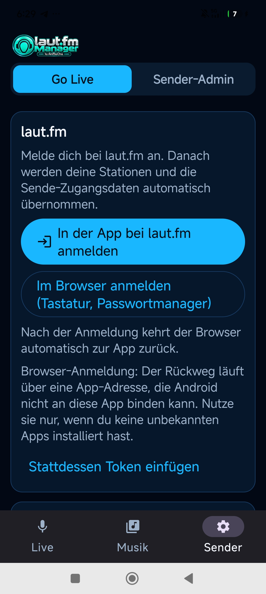</a><br><sub>Screenshot 01</sub></td>
    <td align="center" width="33%"><a href="Screenshot_2026-10-21-06-29-22-603_de.anmacha.laufmmanager.jpg">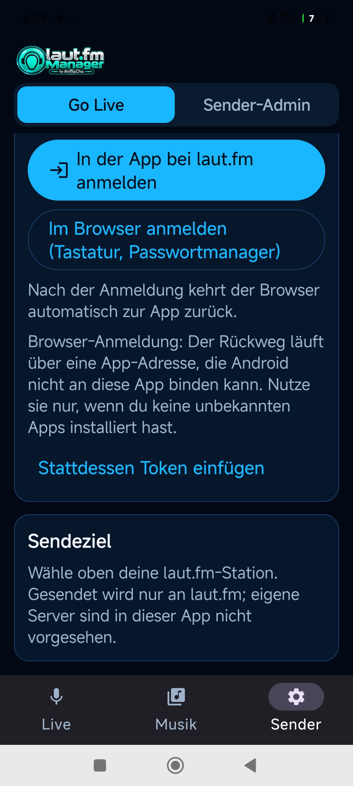</a><br><sub>Screenshot 02</sub></td>
    <td align="center" width="33%"><a href="Screenshot_2026-10-21-06-29-28-027_de.anmacha.laufmmanager.jpg">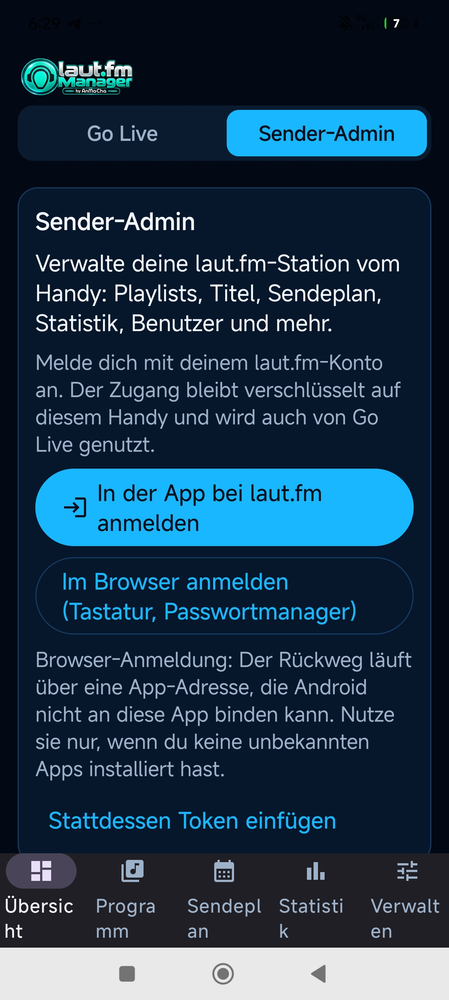</a><br><sub>Screenshot 03</sub></td>
  </tr>
  <tr>
    <td align="center" width="33%"><a href="Screenshot_2026-10-21-06-30-05-263_de.anmacha.laufmmanager.jpg">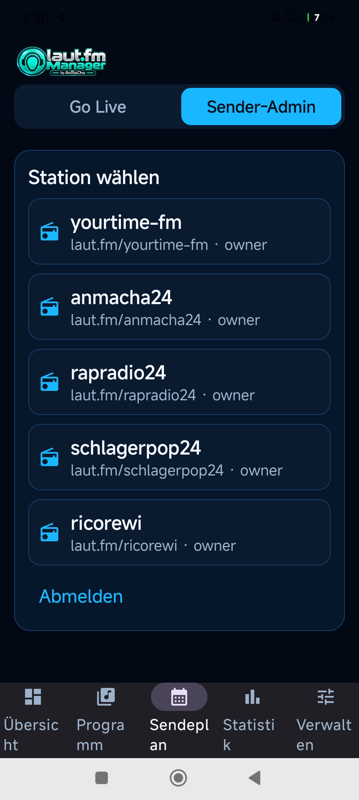</a><br><sub>Screenshot 04</sub></td>
    <td align="center" width="33%"><a href="Screenshot_2026-10-21-06-30-43-835_de.anmacha.laufmmanager.jpg">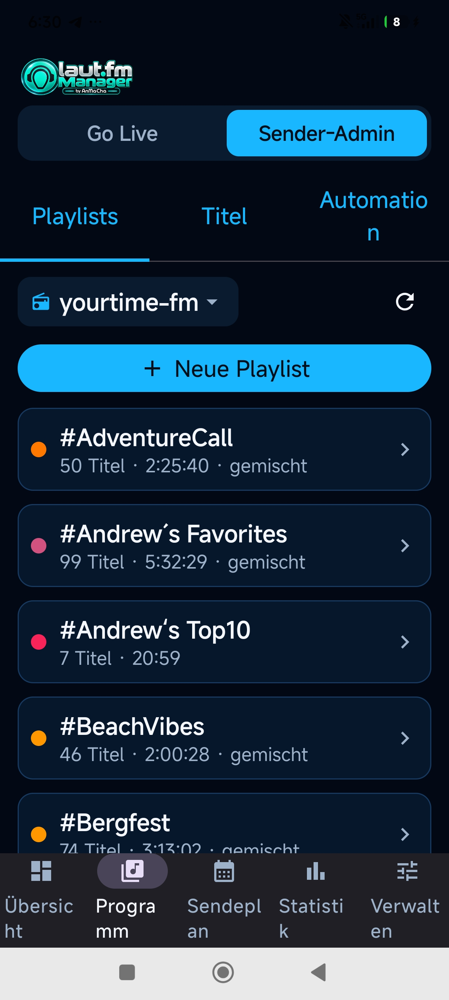</a><br><sub>Screenshot 05</sub></td>
    <td align="center" width="33%"><a href="Screenshot_2026-10-21-06-31-21-245_de.anmacha.laufmmanager.jpg">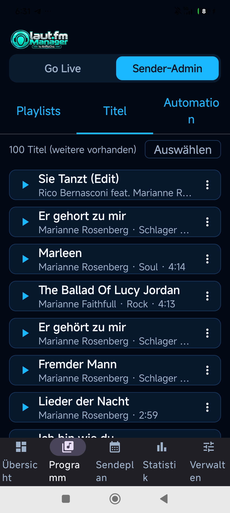</a><br><sub>Screenshot 06</sub></td>
  </tr>
  <tr>
    <td align="center" width="33%"><a href="Screenshot_2026-10-21-06-31-46-751_de.anmacha.laufmmanager.jpg">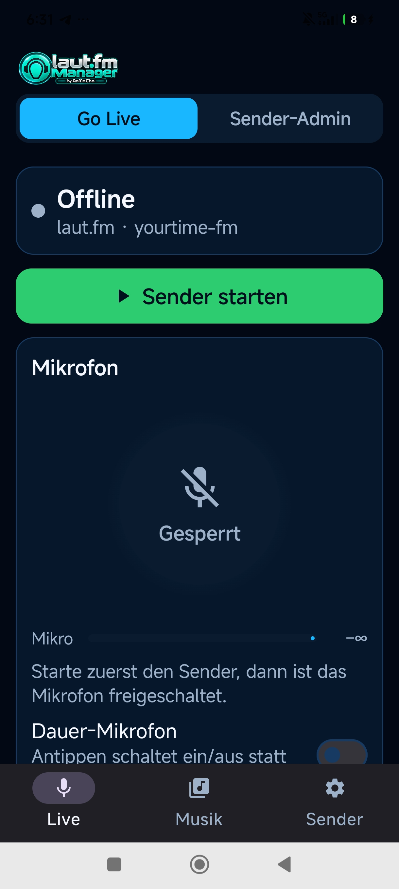</a><br><sub>Screenshot 07</sub></td>
    <td align="center" width="33%"><a href="Screenshot_2026-10-21-06-32-20-655_de.anmacha.laufmmanager.jpg">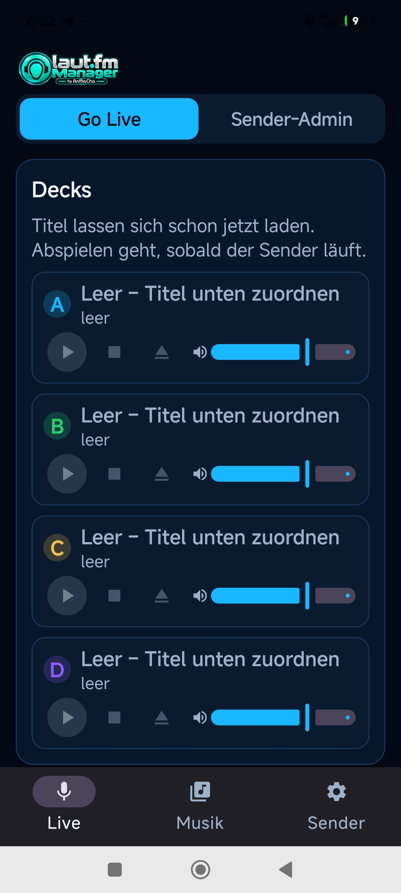</a><br><sub>Screenshot 08</sub></td>
    <td align="center" width="33%"><a href="Screenshot_2026-10-21-06-32-23-742_de.anmacha.laufmmanager.jpg">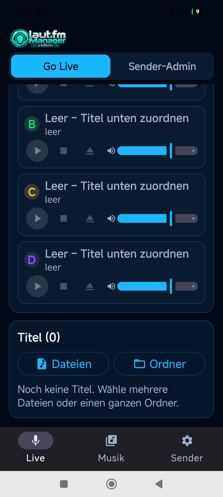</a><br><sub>Screenshot 09</sub></td>
  </tr>
  <tr>
    <td align="center" width="33%"><a href="Screenshot_2026-10-21-06-32-40-740_de.anmacha.laufmmanager.jpg">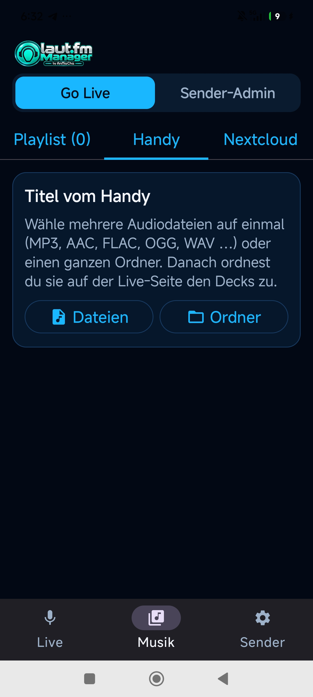</a><br><sub>Screenshot 10</sub></td>
    <td align="center" width="33%"><a href="Screenshot_2026-10-21-06-32-43-387_de.anmacha.laufmmanager.jpg">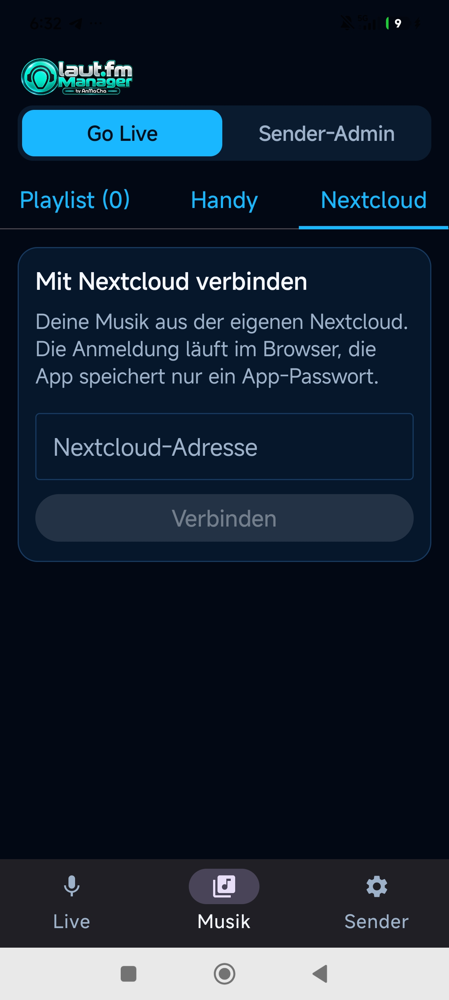</a><br><sub>Screenshot 11</sub></td>
    <td></td>
  </tr>
</table>

## 📥 APK herunterladen

### ➡️ [laut.fm Manager 1.0.1 – APK direkt von GitHub herunterladen](https://github.com/ricorewioriginal-collab/laut-fm-manager-android/raw/refs/heads/main/LautFmManager.apk)

Die veröffentlichte Version **1.0.1** ist eine intern signierte APK, die **nicht über den Google Play Store** verteilt wird. Der **APK-Download erfolgt ausschließlich über GitHub**. Die signierte Originaldatei liegt als [`LautFmManager.apk`](LautFmManager.apk) direkt in diesem Repository.

| Information | Wert |
|---|---|
| App-Version | 1.0.1 |
| Mindestversion | Android 8.0 (API 26) |
| Paketname | `de.anmacha.laufmmanager` |
| Signatur | Intern / Entwickler-Build |
| Offizielle laut.fm-App? | Nein |
| Weiterentwicklung durch den ursprünglichen Autor | Eingestellt |

### ⚠️ Installation und Sicherheit

- Bei der Installation aus einer externen Quelle kann **Google Play Protect** eine Sicherheitsprüfung durchführen oder warnen. Eine Warnung ist nicht automatisch ein Nachweis für Schadsoftware, sollte aber **immer sorgfältig geprüft** werden.
- Um eine APK außerhalb des Play Stores zu installieren, muss Android gegebenenfalls der verwendeten App (Browser/Dateimanager) die Berechtigung **„Unbekannte Apps installieren“** erteilen.
- Nach der Installation sollte diese Berechtigung wieder deaktiviert werden.
- Bei einem von anderen Personen selbst gebauten APK können **abweichende Signaturen** vorliegen. Updates sind dann nicht unbedingt ohne vorherige Deinstallation möglich.
- Installation und Nutzung auf eigene Verantwortung.

## 🎛️ Funktionsumfang

### 📻 Sender-Admin
- Stationen und grundlegende Einstellungen
- Playlists und Musiktitel
- Sendeplan und Automation
- Statistiken / Werbe-Log
- Benutzerverwaltung
- Titel suchen, hochladen, bearbeiten und vorhören (je nach API-Verfügbarkeit)

### 🔴 Go LIVE (experimentell)
- Das Android-Smartphone als mobiles Sendestudio
- Mikrofon, Musik und vier Decks
- Audio-Mixer, Pegel, Ducking und Push-to-Talk
- Streaming zur gewählten laut.fm-Station
- Lokale Musikdateien sowie optional ein eigener Nextcloud-Musikpool

**Wichtig:** Go LIVE ist ein experimentelles Feature, kein zugesicherter stabiler Sendebetrieb. API- und Login-Verhalten von laut.fm können sich ändern.

## 🧪 Stand der Tests

Das ursprüngliche Projekt wurde unter anderem mit Android SDK 35 und Gradle gebaut und verfügte über Unit-Tests. Laut der ursprünglichen Projektdokumentation erfolgte dort **kein vollständiger Praxistest auf einem realen Android-Gerät oder Emulator**. Insbesondere Anmeldung, tatsächliche Radioadmin-Aufrufe und Live-Senden sind deshalb **nicht als durchgehend verifiziert** anzusehen.

## 👩‍💻 Quellcode selbst bauen

Voraussetzungen: **JDK 17+**, **Android SDK**, Internetzugang für Gradle.

```bash
git clone https://github.com/ricorewioriginal-collab/laut-fm-manager-android.git
cd laut-fm-manager-android
./gradlew testDebugUnitTest
./build-apk.sh
```

Der Build erstellt bei Bedarf einen **eigenen lokalen Signierschlüssel** unter `signing/` und erzeugt die APK unter `dist/`. Die vorhandenen privaten Schlüssel und Signierpasswörter **gehören nicht** in dieses Repository und werden nicht veröffentlicht.

**Achtung:** Selbst gebaute APKs mit einem anderen Schlüssel können die ursprüngliche 1.0.1 unter Umständen nicht direkt aktualisieren.

### Projektaufbau

- `app/` – native Kotlin/Jetpack-Compose-App
- `engine/` – Audio- und Streaming-Engine (Java)
- `native/` – Android-Integration der Engine
- `gradle/`, `gradlew` – Build-Tooling
- `build-apk.sh` – Build-/Signierskript
- `create-signing-key.sh` – erzeugt einen **neuen** lokalen Schlüssel
- [`LautFmManager.apk`](LautFmManager.apk) – signierte Original-APK der Version 1.0.1, direkt auf GitHub herunterladbar
- `dist/LautFmManager.json` – Metadaten des veröffentlichten Builds

## ❤️ Erlaubnis zur Weiterentwicklung

Die Anwendung war ein privates Testprojekt und wird von mir nicht weiterentwickelt. **Jeder darf meine eigenen Projektbestandteile untersuchen, dekompilieren, forken, verändern und eigenständig fortführen, verbessern und verbreiten.** Vielleicht entsteht daraus eine tolle Community-App! 🙏😃

Der von mir stammende Code steht unter der **MIT-Lizenz** (siehe [LICENSE](LICENSE)). Fremdcode, verwendete Bibliotheken, Marken, Logos und sonstige Inhalte Dritter unterliegen ihren jeweiligen Rechten und Lizenzen. Insbesondere stellt dieses Repository **keine Freigabe durch laut.fm** dar. Bitte beachtet bei eigenen Änderungen die Rechte an Musiktiteln, die Nutzungsbedingungen und die zugelassenen Schnittstellen.

**Issues, Forks und Community-Weiterentwicklungen sind willkommen – ohne Wartungs- oder Supportzusage.**

---

Viel Spaß beim Basteln und Radiomachen! 📻🎶

**RicoReWi**
